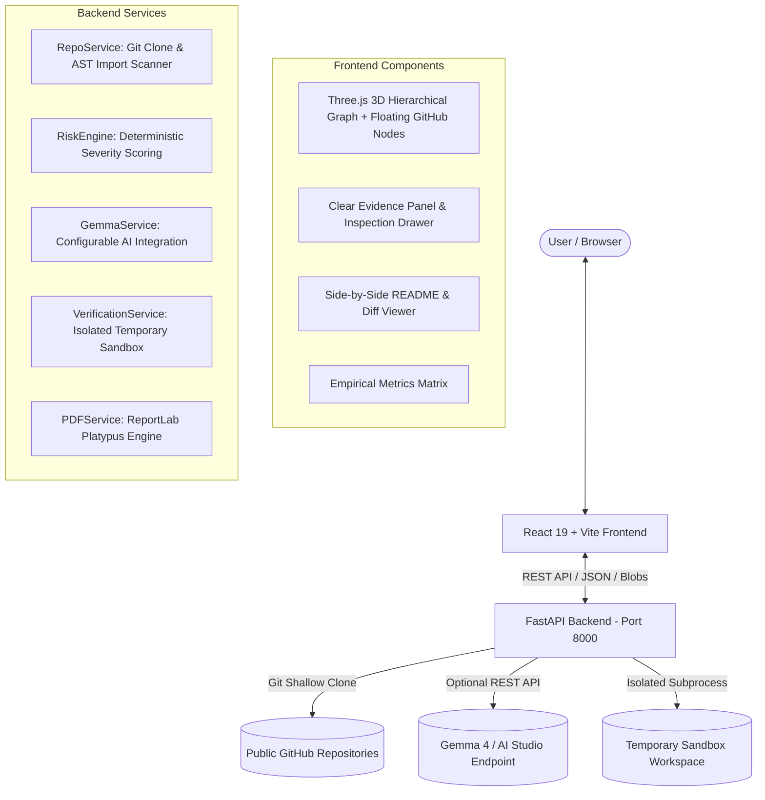

# DepShield — AI Dependency Resilience Engine

> **Understand the risk. Plan the migration. Prove the result.**  
> An open-source, evidence-grounded dependency resilience platform combining deep AST code analysis, interactive 3D graph exploration, AI-guided migration planning, isolated sandbox verification, and publication-ready PDF reporting.

[](LICENSE)
[](https://www.python.org/)
[](https://nodejs.org/)
[](https://threejs.org/)

---

## 1. Problem and Solution Overview

### The Problem
Modern software applications rely heavily on external open-source dependencies. However, dependencies introduce subtle, compounding risks over time:
- **Maintenance Abandonment**: Upstream maintainers archive or abandon repositories, leaving security vulnerabilities and bugs unpatched.
- **Unpinned Constraints**: Wildcard or unconstrained dependencies (`*`, `>=1.0`) cause non-deterministic builds and sudden runtime breakage when upstream packages release breaking updates.
- **Runtime Deprecations**: Modern runtime updates (such as Python 3.12 and 3.13 deprecating `distutils`, `imp`, and async modules) cause legacy packages to fail abruptly in production.
- **Documentation Drift**: Repository `README.md` files rarely match actual code entry points, environment variables, or dependency requirements, confusing contributors and CI/CD engineers.

### The Solution: DepShield
DepShield provides an end-to-end resilience engine that analyzes real GitHub repositories:
1. **Dynamic AST Repository Acquisition**: Shallow-clones target repositories and scans source code files to locate actual `import` and `require` sites with line numbers and snippets.
2. **Interactive 3D Hierarchical Explorer**: Visualizes the dependency network in 3D using Three.js, organizing direct runtime dependencies on an inner ring, dev/transitive packages on an outer ring, and floating animated GitHub repository nodes.
3. **Traceable Evidence & Severity Scoring**: Evaluates observed maintenance facts (deprecation notices, wildcard constraints, high coupling) and surfaces them in a dedicated Evidence Panel.
4. **AI-Guided Migration Planning**: Utilizes Gemma to explain architectural impact, propose battle-tested replacements, and generate code/manifest diffs.
5. **Isolated Sandbox Verification**: Executes baseline checks and tests proposed package migrations in isolated temporary directories.
6. **Side-by-Side README Documentation Repair**: Synthesizes entry points, environment variables, and manifests to generate an audited `README.md` with a unified diff viewer.
7. **Downloadable ReportLab PDF Reports**: Compiles executive before-and-after comparison reports using ReportLab Platypus.

---

## 2. Setup Instructions

### Prerequisites
- **Python**: Version 3.11, 3.12, or 3.13.
- **Node.js**: Version 18.0.0 or higher (Node 20+ recommended) with `npm`.
- **Git**: Installed and available in your system path.

### Installation

1. **Clone the repository:**
   ```bash
   git clone https://github.com/vaishnavyewale39/H26_Quadbit_DepShield.git
   cd H26_Quadbit_DepShield
   ```

2. **Backend Setup:**
   ```bash
   # Create and activate Python virtual environment
   python -m venv venv
   # On Windows (PowerShell):
   .\venv\Scripts\activate
   # On macOS/Linux:
   source venv/bin/activate

   # Install backend dependencies
   pip install -r backend/requirements.txt
   ```

3. **Frontend Setup:**
   ```bash
   cd frontend
   npm install
   cd ..
   ```

4. **Configure Environment Variables:**
   Create a `.env` file inside `backend/` (or copy from `.env.example`):
   ```bash
   # backend/.env
   GEMMA_API_KEY=your_gemma_api_key_here
   GEMMA_MODEL=gemma-4-27b-it
   GEMMA_API_BASE=https://generativelanguage.googleapis.com/v1beta
   ```
   *Note: If `GEMMA_API_KEY` is omitted or offline, DepShield activates its local heuristic resilience engine so all features remain functional.*

### Starting the Servers

1. **Start the FastAPI Backend:**
   ```bash
   # From the project root
   .\venv\Scripts\python -m uvicorn app.main:app --app-dir backend --host 127.0.0.1 --port 8000 --reload
   ```
   - REST API Documentation: [http://127.0.0.1:8000/docs](http://127.0.0.1:8000/docs)
   - Health Check: [http://127.0.0.1:8000/api/health](http://127.0.0.1:8000/api/health)

2. **Start the Vite Frontend:**
   ```bash
   # In a separate terminal
   cd frontend
   npm run dev
   ```
   - Application Web UI: [http://localhost:5173](http://localhost:5173)

---

## 3. Usage Instructions

1. **Open the Application**: Navigate to `http://localhost:5173`.
2. **Input Repository**: Enter any public GitHub repository URL (e.g. `https://github.com/rishrek/LinkWatch`) or click one of the quick samples.
3. **Execute Scan**: Click **Analyze Repository**. The real-time progress bar reflects repository cloning, manifest discovery, AST import scanning, and risk assessment.
4. **Explore the 3D Dependency Graph**:
   - Access the **3D Explorer** tab.
   - Rotate, pan, and zoom around the central root repository node.
   - Observe direct runtime dependencies arranged on the inner orbit and dev dependencies on the outer orbit.
   - Click floating GitHub icons to open the target repository on GitHub.
   - Click any dependency node to inspect its telemetry in the **Evidence Panel**.
5. **Inspect Clear Evidence**:
   - The dedicated Evidence Panel displays the finding title, severity, affected version, source file, AST import locations, and classification rationale.
6. **Review AI Recommendations**:
   - Inspect proposed modernizations (e.g. migrating `requests` to `httpx` or `moment` to `date-fns`).
   - Review code diffs and manifest updates.
7. **Execute Sandbox Verification**:
   - Click **Open Full Inspection & Sandbox Test** to test candidate package migrations in a temporary directory.
8. **Improve and Compare README**:
   - Navigate to the **README Improver** tab to inspect original vs. proposed documentation, toggle unified git diffs, and download `README.md`.
9. **Export PDF Report**:
   - Click **Export Report** in the Navbar or in the **Before vs After** tab to generate a publication-ready ReportLab Platypus PDF.

---

## 4. Architecture



### Component Breakdown
- **Frontend**: Single-page application built with React, Three.js, OrbitControls, and Tailwind CSS.
- **Backend**: Asynchronous REST API powered by FastAPI, Pydantic data schemas, and Uvicorn.
- **Repository Ingestion**: Utilizes Git for depth-1 cloning and parses `pyproject.toml`, `requirements.txt`, `Pipfile`, `package.json`, `Cargo.toml`, and `go.mod`.
- **AST Code Scanner**: Iterates through source code files to identify live `import` / `require` statements, line numbers, and code snippets.
- **Isolated Sandbox**: Spawns isolated temporary directories to test manifest syntax and package importability without host pollution.
- **PDF Engine**: Builds multi-page documents using ReportLab Platypus with two-pass canvas page numbering.

---

## 5. Dependencies

### Frontend Dependencies
| Package | Version | Purpose | License |
| :--- | :--- | :--- | :--- |
| `react` / `react-dom` | `^19.2.8` | Core UI component framework | MIT |
| `three` | `^0.186.1` | WebGL 3D rendering engine | MIT |
| `@react-three/fiber` | `^9.8.2` | Declarative Three.js wrapper | MIT |
| `@react-three/drei` | `^10.7.9` | Three.js helpers and controls | MIT |
| `lucide-react` | `^1.57.0` | UI icon set | ISC |
| `framer-motion` | `^14.2.0` | Micro-animations and transitions | MIT |
| `recharts` | `^3.10.1` | Data visualization charts | MIT |
| `diff` | `^9.0.0` | Unified text diff generation | BSD-3-Clause |
| `tailwindcss` | `^4.3.3` | Utility-first CSS engine | MIT |

### Backend Dependencies
| Package | Version | Purpose | License |
| :--- | :--- | :--- | :--- |
| `fastapi` | `0.115.8` | Asynchronous web framework | MIT |
| `uvicorn` | `0.34.0` | ASGI web server | BSD-3-Clause |
| `pydantic` | `2.10.6` | Data validation and settings | MIT |
| `reportlab` | `4.3.1` | Programmatic PDF generation engine | BSD-3-Clause |
| `httpx` | `0.28.1` | Asynchronous HTTP client for AI APIs | BSD-3-Clause |
| `requests` | `2.32.3` | Synchronous HTTP utilities | Apache-2.0 |
| `python-dotenv` | `1.0.1` | Environment variable loader | BSD-3-Clause |
| `toml` | `0.10.2` | Parser for `pyproject.toml` manifests | MIT |

---

## 6. AI Model Details

- **Model Name**: Gemma 4 / Gemma 2
- **Configured Identifier**: `gemma-4-27b-it` (configurable via `GEMMA_MODEL` in `.env`)
- **Model Provider**: Google AI Studio (Generative Language API) / OpenRouter / OpenAI-compatible endpoint
- **Access Method**: Direct backend REST client via `httpx` (`generateContent` endpoint). Credentials remain strictly in `backend/.env` and are never exposed to the frontend.
- **License / Terms**: Open-weights model governed by the Gemma Terms of Use.
- **Role in DepShield**:
  1. **Risk Explanation**: Synthesizes AST code import locations and manifest constraints to explain the architectural root cause of maintenance issues.
  2. **Migration Planning**: Generates step-by-step refactoring guidelines, manifest diffs, and code modification snippets.
  3. **README Documentation Enhancement**: Scans project entry points and environment variables to formulate structured, production-grade documentation.
  4. **Executive Summary**: Generates a 3-paragraph comparison contrasting before and after states.
- **Resilience Fallback**: If an API key is not configured or network access is unavailable, DepShield activates its internal **Deterministic Heuristic Engine**, which uses curated ecosystem rules to provide evidence-based recommendations and migration plans without failing.

---

## 7. Known Limitations

1. **Ecosystem Depth**: Python (`pyproject.toml`, `requirements.txt`, `Pipfile`) and Node.js (`package.json`, `package-lock.json`) are fully parsed for dependencies and AST imports. Rust (`Cargo.toml`) and Go (`go.mod`) are manifest-parsed; lockfile deep traversal is in progress.
2. **Vulnerability Data**: DepShield focuses on dependency resilience, maintenance risk, and runtime deprecation. It does not query live external CVE databases (e.g. NVD/OSV); findings represent codebase maintenance analysis.
3. **Private Repositories**: Currently supports public GitHub repositories. Private repository cloning requires personal access tokens not yet exposed in the UI.
4. **In-Memory State**: Active scan sessions are stored in backend memory; restarting the server clears active session cache.
5. **Sandbox Isolation**: Verification tests execute in temporary isolated directories with timeouts; full containerization (e.g. Docker-in-Docker) is recommended for running untrusted third-party code in multi-tenant environments.

---

## 8. Explain AI Integration and Original Contribution

### AI Integration
DepShield connects to Gemma through an asynchronous backend service. When a repository is scanned:
1. Manifest data, declared versions, AST import locations, and detected ecosystem markers are extracted deterministically.
2. Concrete evidence (e.g. `requests` imported across 4 files, unpinned wildcard specifier) is packaged into a structured prompt.
3. Gemma generates contextual explanations, refactoring diffs, and documentation drafts.
4. The UI explicitly separates verified scanner evidence (green/neutral tags) from AI recommendations (Gemma tags) so users can distinguish observed facts from AI advice.

### Original Contribution
- **AST-Based Import Coupling**: Scans source files to count and display exact call sites, showing users where a dependency is actively used rather than just listing it.
- **Hierarchical 3D Orbit Visualization**: Arranges dependencies in concentric rings (Root &rarr; Direct Runtime &rarr; Dev/Transitive) with floating animated GitHub tokens in Three.js.
- **Automated Isolated Verification**: Spins up temporary isolated workspaces to verify whether proposed migrations pass syntax and manifest checks.
- **Automated README Repair with Diff**: Discovers entry points and environment variables from code to generate comprehensive documentation with a side-by-side unified diff.
- **Publication-Ready Platypus PDF Generator**: Produces branded, multi-page PDF reports with two-pass canvas page numbering.

---

## 9. Live Demo Workflow

For an organized, reliable presentation:

1. **Launch Application**: Open `http://localhost:5173`.
2. **Target Repository**: Enter `https://github.com/rishrek/LinkWatch` (or any public repository provided by the organizer).
3. **Analyze**: Click **Analyze Repository** and watch the real-time progress bar.
4. **Explore 3D Graph**:
   - Rotate, pan, and zoom around the concentric 3D orbit layers.
   - Click a floating GitHub token to open the repository.
   - Click a dependency node (e.g. `requests`) to open the **Clear Evidence Panel**.
5. **Inspect Evidence**:
   - Review observed AST import locations (`linkwatch/checker.py`, `linkwatch/encoding.py`, etc.).
   - Review the risk severity and rationale.
6. **Execute Sandbox Verification**:
   - Click **Open Full Inspection & Sandbox Test**.
   - Navigate to the **Isolated Verification** tab and click **Execute Sandbox Test**.
   - Observe real execution logs, duration, and exit code.
7. **Review README Improver**:
   - Switch to the **README Improver** tab.
   - Toggle **Side-by-Side** and **Unified Diff** views to show added architecture, setup steps, and environment variables.
8. **Inspect Before vs After**:
   - Switch to the **Before vs After** tab to review the empirical metrics comparison matrix and modernization candidate cards.
9. **Export PDF Report**:
   - Click **Export Report** to download the generated `DepShield_Report_rishrek_LinkWatch.pdf` and view the final publication document.

---

## 10. Open-Source License

This project is open-source software licensed under the **[MIT License](LICENSE)**.

Third-party dependencies (Three.js, React, FastAPI, ReportLab) are distributed under their respective permissive open-source licenses (MIT, BSD-3-Clause, Apache-2.0).
